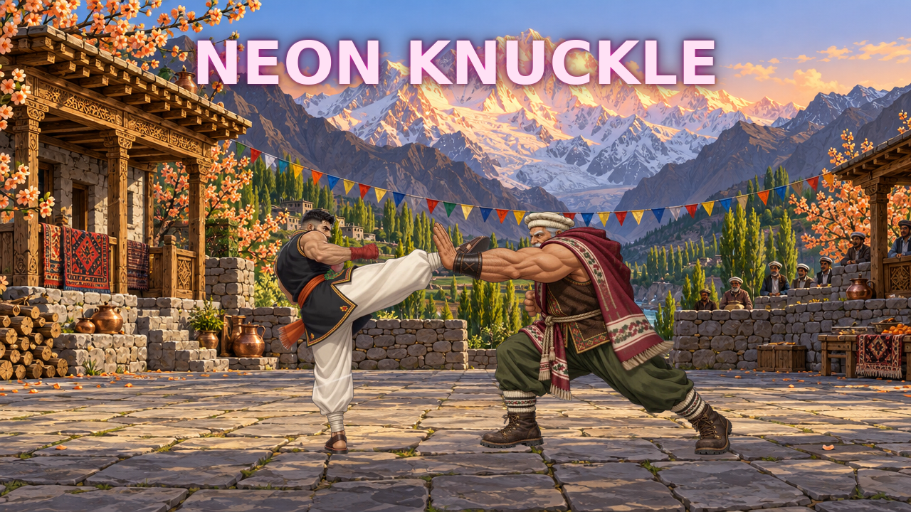

# Neon Knuckle

A 2D arcade fighting game set in Pakistan, made in Godot 4.5. Two fighters, two stages, full voice acting, and breakable stage props.



The character art and animation come from AI-generated video, cut frame by frame into sprite sheets. The voices, announcer, sound effects and music were generated with ElevenLabs. The fighters and stages are original to this game.

## Download

Get the latest Linux or Windows build from **[Releases](https://github.com/quietbytehq/neon-knuckle/releases)**, unzip it, and run `NeonKnuckle.x86_64` (Linux) or `NeonKnuckle.exe` (Windows).

To run it from source, open `project.godot` in Godot 4.5 and press **F5**.

## Fighters

| | **Rustam**, Karachi | **Baba Sher**, Hunza |
|---|---|---|
| Style | Fast street fighter | Slow, heavy mountain wrestler |
| Health | 1000 | 1150 |
| Punch | Quick jab | Heavy open-palm strike |
| Kick | Roundhouse to the head | Front push kick (big knockback) |
| Down + Kick | Low sweep | Low leg sweep |
| Special | **Storm Fist!** Chi fireball at chest height | **Earthquake!** Ground-pound shockwave that rolls along the floor. Jump over it, or crouch-block it. |

## Stages

- **Karachi Rooftop:** a night-time rooftop over the city skyline, with fairy lights and a rickshaw-art mural.
- **Hunza Valley:** a village courtyard under Rakaposhi at golden hour.

Each stage has its own music and its own props: crates, clay pots, barrels, apricot baskets, copper pots and firewood. They wobble and slide when you bump them, tumble when hit, and shatter when you smash them with attacks, specials, or your opponent's body.

## Controls

| Action  | Player 1 keyboard | Player 2 keyboard | Joypad (Xbox / PlayStation) |
|---------|-------------------|-------------------|-----------------------------|
| Move    | A / D             | ← / →             | D-pad or left stick         |
| Jump    | W                 | ↑                 | Up                          |
| Crouch  | S                 | ↓                 | Down                        |
| Punch   | J                 | Numpad 1          | X / Square                  |
| Kick    | K                 | Numpad 2          | A / Cross                   |
| Special | L                 | Numpad 3          | B / Circle                  |
| Pause   | Enter or Esc      | Enter             | Start                       |

- Joypad 1 controls player 1 and joypad 2 controls player 2.
- **Arcade** mode puts you against the CPU (Easy, Normal or Hard). **Versus** mode is for two players. F2 switches player 2 between the CPU and a human at any time.
- **Special:** Down, Down-Forward, Forward + Punch, or the Special button. It has a short cooldown.
- **Block:** hold away from your opponent. Low attacks such as the shockwave need a crouching block (back + down). Blocked hits do 10% damage.
- **Combos:** hits that land while the opponent is still reeling count towards a combo.

Matches are best of three rounds, with 99 seconds per round.

## Project layout

```
assets/<fighter>/   sprite sheets + <fighter>_sprites.json (frame size, fps, feet anchor)
assets/stage/       stage backgrounds
assets/audio/       announcer, fighter voices, sfx, music (.ogg)
scripts/
  characters.gd     roster: stats, attacks, specials (add new fighters here)
  controls.gd       keyboard + joypad input map (autoload)
  sound.gd          sfx, voices, announcer, music (autoload)
  sprite_library.gd builds SpriteFrames from the sheets
  fighter.gd        movement, attacks, hitboxes, blocking, combos, CPU
  fireball.gd       special-move projectiles (fireball, shockwave)
  prop.gd           breakable / movable stage props (+ prop_piece.gd fragments)
  main.gd           title, character + stage select, rounds, pause, HUD
tools/              the sprite pipeline (frame extraction, background removal, packing)
```

## Adding a fighter

1. Generate the nine animations (idle, walk, jab, roundhouse, crouch_kick, jump, special, hit, knockdown) as short clips on a plain background. Each clip should start from the same reference image.
2. Run `tools/cut_move.py` for each clip, then `tools/pack_char.py` to build the sheets in `assets/<id>/`.
3. Put the voice lines in `assets/audio/<id>/`.
4. Add an entry to `Characters.DATA` and its id to `Characters.ROSTER`.

## Releasing

Push a tag such as `v0.1.0`. GitHub Actions exports the Linux and Windows builds and attaches them to a release.

## License

Apache-2.0. See [LICENSE](LICENSE) and [NOTICE](NOTICE).
