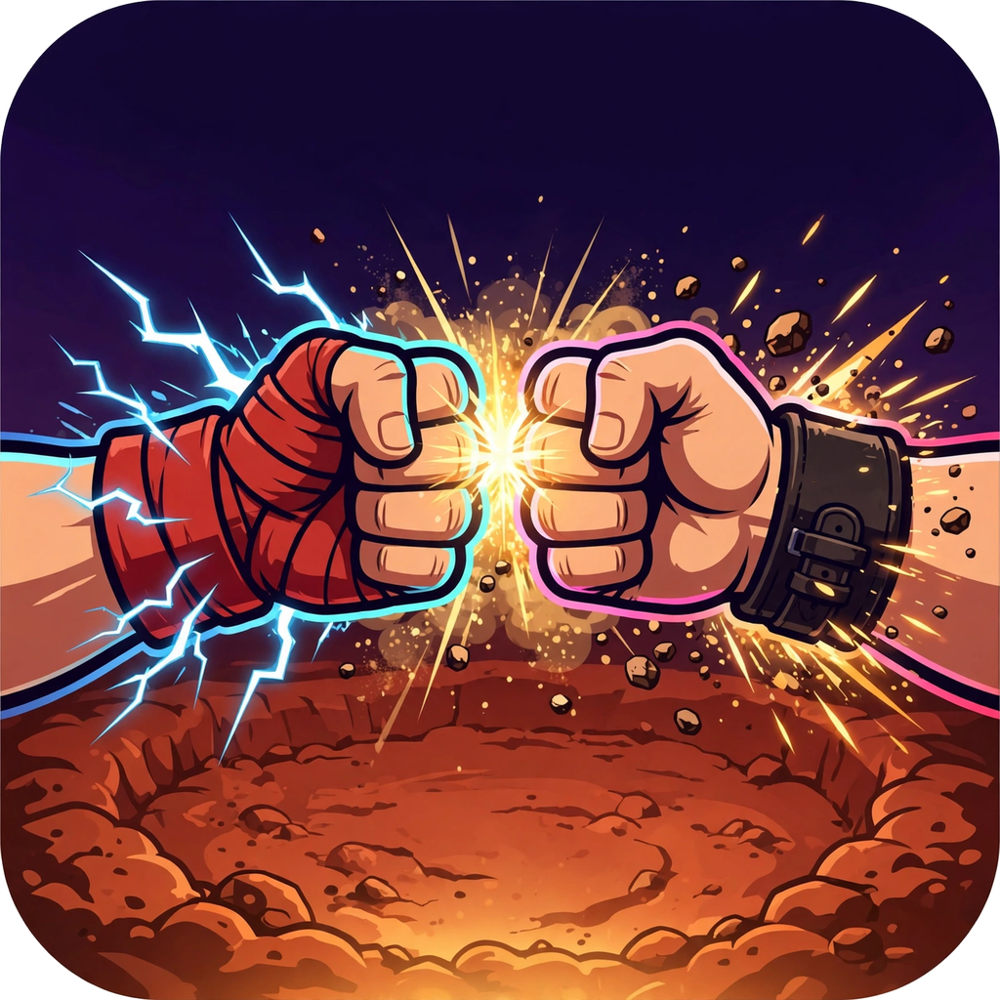

# Dangal

*Dangal* means a wrestling bout. It's a 2D arcade fighting game set in Pakistan, made in Godot 4.5, with two fighters, two animated stages, full voice acting, ultra moves with cinematic cut-ins, pre-fight call-outs, post-fight taunts, and breakable stage props.


The character art and animation come from AI-generated video, cut frame by frame into sprite sheets. The voices, announcer, sound effects and music were generated with ElevenLabs. The fighters and stages are original to this game.

## Download

Get the latest build from **[Releases](https://github.com/quietbytehq/dangal/releases)**:

| Platform | File | How |
|---|---|---|---|
| Linux (any distro) | `Dangal-<version>-x86_64.AppImage` | `chmod +x` it, then run it |
| Ubuntu / Debian | `dangal_<version>_amd64.deb` | `sudo apt install ./dangal_<version>_amd64.deb`, then find **Dangal** in your apps |
| Windows 10/11 | `Dangal-<version>-Setup.exe` | Run the installer; it adds Start Menu and desktop shortcuts and an uninstaller |

To run it from source, open `project.godot` in Godot 4.5 and press **F5**.

## Fighters

| | **Rustam**, Karachi | **Baba Sher**, Hunza | **Tiago**, Rio de Janeiro |
|---|---|---|
| Style | Fast street fighter | Slow, heavy mountain wrestler | Quick Brazilian jiu-jitsu grappler |
| Health | 1000 | 1150 | 980 |
| Punch | Quick jab | Heavy open-palm strike | Straight jab |
| Kick | Roundhouse to the head | Front push kick (big knockback) | Front push kick |
| Down + Punch | Low punch | Low palm strike | Low single-leg shot |
| Down + Kick | Low sweep | Low leg sweep | Scissor sweep |
| Jump + Punch / Kick | Diving punch / flying kick | Diving hammer fist / flying knee | Jumping punch / flying knee |
| Special | **Storm Fist!** Chi fireball at chest height | **Earthquake!** Ground-pound shockwave that rolls along the floor. Jump over it, or crouch-block it. | **Jaguar Shot!** A charging double-leg tackle wrapped in green energy |
| Kick special | **Hurricane Kick!** Spinning multi-hit kick that travels forward | **Avalanche!** Axe kick that shakes the ground and erupts rocks | **Flying Armbar!** A spinning leap that hits twice |
| Ultra | **Lightning Storm!** A screen-wide lightning beam | **Mountain Breaker!** Rock eruptions sweep the whole floor. Jump it, or crouch-block it. | **Rio Submission!** A green-energy rush across the floor that slams into the opponent |

## Stages

- **Karachi Rooftop:** a night-time rooftop over the city skyline, with fairy lights and a rickshaw-art mural.
- **Hunza Valley:** a village courtyard under Rakaposhi at golden hour.

Both backgrounds are animated loops with extra life on top: kites, crows, a passing plane and twinkling city lights over Karachi; drifting clouds, circling eagles, falling blossom petals and a sparkling river in Hunza.

Each stage has its own music and its own props: crates, clay pots, barrels, apricot baskets, copper pots and firewood. They wobble and slide when you bump them, tumble when hit, and shatter when you smash them with attacks, specials, or your opponent's body.

## Controls

| Action  | Player 1 keyboard | Player 2 keyboard | Joypad (Xbox / PlayStation) |
|---------|-------------------|-------------------|-----------------------------|
| Move    | A / D             | ← / →             | D-pad or left stick         |
| Jump    | W                 | ↑                 | Up                          |
| Crouch  | S                 | ↓                 | Down                        |
| Punch   | J                 | Numpad 1          | X / Square                  |
| Kick    | K                 | Numpad 2          | A / Cross                   |
| Special | L                 | Numpad 3          | B / Circle                  |
| Ultra   | I                 | Numpad 4          | Y / Triangle                |
| Pause   | Enter or Esc      | Enter             | Start                       |

- Joypad 1 controls player 1 and joypad 2 controls player 2.
- **Arcade** mode puts you against the CPU (Easy, Normal or Hard). **Versus** mode is for two players. F2 switches player 2 between the CPU and a human at any time.
- **Special:** Down, Down-Forward, Forward + Punch, or the Special button. It has a short cooldown.
- **Kick special:** Down, Down-Forward, Forward + Kick, or Forward + Special.
- **Ultra:** the blue meter under your health fills as you hit, get hit and block. When it reads ULTRA READY, press Ultra.
- **Block:** hold away from your opponent, standing or crouching; every attack can be blocked. Your fighter raises a guard when an attack is coming. Blocked hits do 10% damage.
- **Air attacks:** press Punch or Kick during a jump.
- **Jump over:** jump towards your opponent to sail over his head and land behind him.
- The fighters can't walk through each other; they push each other along instead.
- The full list of controls and moves is in **HOW TO PLAY**, on the title screen and in the pause menu.
- **Combos:** hits that land while the opponent is still reeling count towards a combo.

Matches are best of three rounds, with 99 seconds per round. Before each match the two fighters call each other out in close-up. The round winner strikes his own victory pose, the announcer calls **YOU WIN** or **YOU LOSE** (or **PLAYER 1 / 2 WINS** in versus), and the winner taunts the beaten loser. Press Punch or Enter to skip either screen.

## Project layout

```
assets/<fighter>/   sprite sheets + <fighter>_sprites.json (frame size, fps, feet anchor)
assets/stage/       stage backgrounds (still images + looping .ogv videos)
assets/vfx/         effect sheets drawn with additive blending (chi orb, fire burst, rocks, lightning)
assets/portraits/   close-ups for the versus and victory screens
assets/audio/       announcer, fighter voices, sfx, music (.ogg)
scripts/
  characters.gd     roster: stats, attacks, specials (add new fighters here)
  controls.gd       keyboard + joypad input map (autoload)
  sound.gd          sfx, voices, announcer, music (autoload)
  sprite_library.gd builds SpriteFrames from the sheets
  fighter.gd        movement, attacks, hitboxes, blocking, combos, CPU
  fireball.gd       special-move projectiles (fireball, shockwave)
  ultra_fx.gd       ultra moves (lightning beam, rock wave)
  vfx.gd            additive effect animations
  prop.gd           breakable / movable stage props (+ prop_piece.gd fragments)
  main.gd           title, character + stage select, rounds, pause, HUD
tools/              the sprite pipeline (frame extraction, background removal, packing)
```

## Adding a fighter

1. Generate the animations (idle, walk, jab, roundhouse, crouch_punch, crouch_kick, jump, jump_punch, jump_kick, special, kick_special, ultra, block, crouch_block, hit, knockdown) as short clips on a plain background. Each clip should start from the same reference image.
2. Run `tools/cut_move.py` for each clip, then `tools/pack_char.py` to build the sheets in `assets/<id>/`.
3. Put the voice lines in `assets/audio/<id>/` and the close-ups (`<id>_callout.jpg`, `<id>_win.jpg`, `<id>_beaten.jpg`) in `assets/portraits/`.
4. Add an entry to `Characters.DATA` and its id to `Characters.ROSTER`.

## Releasing

Push a tag such as `v0.1.0`. GitHub Actions exports the Linux and Windows builds and attaches them to a release.

## License

Apache-2.0. See [LICENSE](LICENSE) and [NOTICE](NOTICE).
